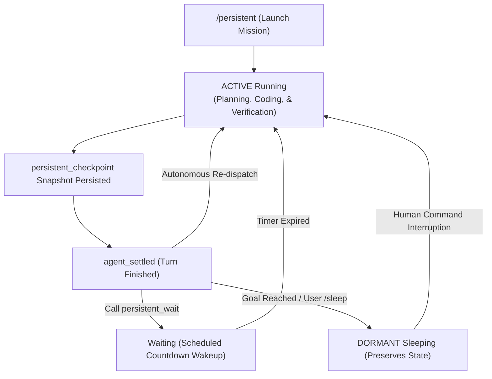

[简体中文](README.md) | English

# pi-persistent

**Autonomous resident execution and long-running mission guard for the Pi Coding Agent.**

Under default conditions, coding agents complete a single user instruction and stop to await input. `pi-persistent` introduces an autonomous mission loop triggered via `/persistent <mission>`. It empowers the agent to traverse standard turn-settling boundaries (`agent_settled`) unattended—running verifications, resolving leftover defects, executing scheduled checks, and pushing multi-phase engineering tasks until completion or explicit `/sleep`.

---

## Key Features

* **Autonomous Re-dispatch Loop**: Listens directly to `agent_settled` events. When the agent host is idle and queues are empty, it automatically dispatches the next in-scope prompt with exponential backoff and watchdog recovery.
* **Workspace Sandbox Guard**:
  * **Deterministic File Confinement**: Resolves physical filesystem paths, rejecting path traversal (`..`), symlinks, and junction breakouts. Confines all write and edit operations strictly within the workspace root.
  * **Heuristic Shell Guard**: Scans shell command patterns for out-of-scope mutations and destructive operations.
  * **Unrestricted Read Access**: Grep, file reads, and directory discovery remain fully available.
* **Immutable Checkpointing & Self-Healing**: Leverages `persistent_checkpoint` to record active milestones, obstacles, and next verification steps into immutable Pi session custom entries. Survives process restarts, compaction, and session tree branches.
* **Scheduled Suspensions (`persistent_wait`)**: Allows the agent to sleep for designated periods (e.g., waiting for builds or test runners) while updating the TUI status bar with live countdowns before auto-waking.
* **Compaction Guard**: Intervenes during context compaction on lengthy runs, summarizing progress without discarding mission-critical state.
* **Human-in-the-Loop Priority**: User keystrokes and manual commands immediately take precedence. Non-blocking UI notifications prevent the autonomous loop from hijacking the terminal.

---

## State Lifecycle



---

## Installation & Setup

### Install via Pi

```bash
pi install git:github.com/DDDFXYqiming/pi-persistent
```

### Local Development

```powershell
git clone https://github.com/DDDFXYqiming/pi-persistent.git
cd pi-persistent
pi -e .\index.ts
```

*Built with TypeScript and loaded directly by Pi's runtime via Jiti—zero build step required.*

---

## Commands & Tools

```text
/persistent <mission>      # Start an autonomous mission with explicit objectives
/persistent                # Inspect current mission status, workspace, and turn counts
/persistent resume         # Resume a dormant mission
/persistent off            # Stop the active mission immediately
/sleep [reason]            # Allow the agent to sleep or stop manually with an optional note
```

### Mission Tools (Injected Only When Active)

* `persistent_checkpoint`: Saves verified milestones, blockers, and next test criteria.
* `persistent_wait`: Suspends the loop for a specified number of seconds before waking.
* `persistent_dormant`: Transitions the agent into sleep when goals are achieved or blocked on missing human credentials.

---

## Compaction Guard Configuration

Customize long-context preservation in `~/.pi/agent/pi-persistent.json`:

```jsonc
{
  "compaction": {
    "mode": "persistent",     // "persistent" (guard active runs), "always", or "off"
    "targetTokens": 3000,     // Compaction target token threshold
    "maxInputChars": 24000,   // Context window character budget
    "maxOutputTokens": 16384, // Summary generation ceiling
    "timeoutMs": 180000,      // Auxiliary request timeout
    "provider": "",           // Dedicated compaction model provider
    "model": ""               // Dedicated compaction model name
  }
}
```

---

## License

This project is open-sourced under the [MIT License](LICENSE).
