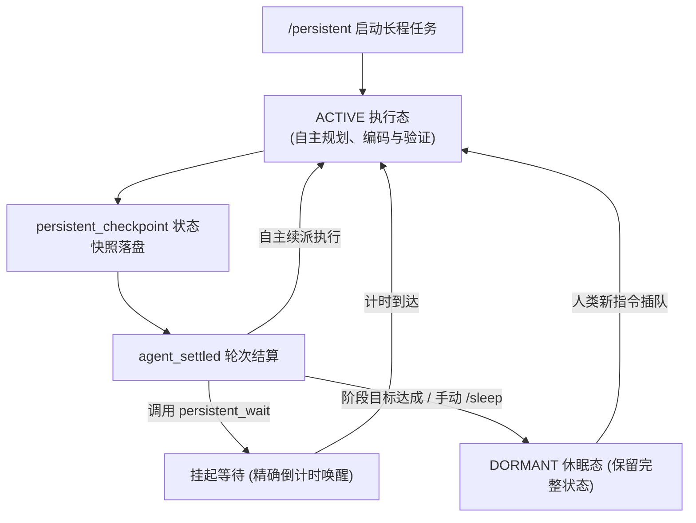

简体中文 | [English](README.en.md)

# pi-persistent

**Pi Coding Agent 的常驻自治执行与长程任务守护扩展**。

在常规模式下，代码智能体在执行完单次指令后便会停下等待用户输入。`pi-persistent` 通过执行 `/persistent <目标>` 赋予智能体跨越回合结算（`agent_settled`）的自主续航能力，让其能够在无人值守时持续自检、解决遗留缺陷、执行定时轮询并推进多阶段工程任务，直至达成终极目标或主动调用 `/sleep` 休眠。

---

## 核心特性

* **自主续航闭环（Autonomous Re-dispatch）**：精准监听 `agent_settled` 事件。在宿主空闲且队列清空后，自动派发下一步推进指令；具备看门狗指数退避与故障重试机制。
* **严格工作区隔离（Workspace Sandbox Guard）**：
  * **确定性路径拦截**：解析真实物理路径，严厉拒绝 `..` 越界、符号链接（Symlink）与 NTFS Junction 逃逸，严格限制文件写入与修改在工作区内部。
  * **Shell 指令动态过滤**：智能扫描高危命令形态与工作区外变更，保护系统核心资产。
  * **只读操作完全放行**：阅读、文件检索与代码语法树分析全量畅通。
* **状态持久化与不可变检查点**：任务执行期间自动调用 `persistent_checkpoint`，将当前进展、阻碍与下一步验证计划写入 Pi Session 不可变元数据。即使进程崩溃、终端重启或进行会话 Fork，也能无缝自愈恢复。
* **定时挂起与唤醒（Scheduled Waking）**：提供 `persistent_wait` 原生工具，允许智能体在等待外部编译、测试运行或特定周期时挂起，状态栏实时倒计时并按计划精准唤醒。
* **智能压缩守护（Compaction Guard）**：在长程任务触发上下文压缩时，守护器自动介入合并历史消息与任务关键上下文，防止超长对话导致的任务失忆。
* **人类干预永远最高优先**：用户随时敲入新指令优先插队响应；UI 状态通知绝不使用阻塞式弹窗抢占交互。

---

## 运行模式与状态流转



---

## 安装与启动

### 安装扩展

```bash
pi install git:github.com/DDDFXYqiming/pi-persistent
```

### 本地路径加载

```powershell
git clone https://github.com/DDDFXYqiming/pi-persistent.git
cd pi-persistent
pi -e .\index.ts
```

*插件基于 TypeScript 编写，由 Pi 内置的 Jiti 引擎直接加载运行，零编译步骤。*

---

## 指令体系

```text
/persistent <mission>      # 启动常驻任务，设定目标与验收范围
/persistent                # 查看当前任务运行状态、工作区与轮次统计
/persistent resume         # 手动唤醒已休眠（dormant）的任务
/persistent off            # 立即停止当前常驻任务
/sleep [reason]            # 智能体主动休眠或手动停止，记录停止原因
```

### 任务内专用工具（仅在激活时注入）

* `persistent_checkpoint`：保存结构化进展、当前阻碍与下次自检条件。
* `persistent_wait`：按指定秒数挂起任务并在到期时恢复。
* `persistent_dormant`：在缺乏必要授权或已圆满达成目标时，主动进入休眠。

---

## 压缩守护配置

若需自定义上下文压缩策略，可在 `~/.pi/agent/pi-persistent.json` 中配置：

```jsonc
{
  "compaction": {
    "mode": "persistent",     // "persistent" (仅守护常驻任务), "always" 或 "off"
    "targetTokens": 3000,     // 压缩目标 Token 上限
    "maxInputChars": 24000,   // 输入上下文截取长度
    "maxOutputTokens": 16384, // 压缩输出 Token 预算
    "timeoutMs": 180000,      // 辅助请求超时时间
    "provider": "",           // 可选独立压缩模型提供商
    "model": ""               // 可选独立压缩模型名称
  }
}
```

---

## 许可证

本项目基于 [MIT License](LICENSE) 开源。
